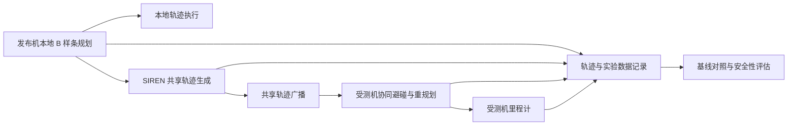

# SIREN：面向多无人机协同规划的共享轨迹安全研究

本项目围绕多无人机协同规划中的**共享未来轨迹可信性**开展研究，实现 SIREN 轨迹生成方法及配套的仿真实验、数据记录和评估工具。

无人机集群通过广播未来轨迹预测邻机运动，并据此完成协同避碰。如果广播轨迹与发布者实际执行的轨迹存在偏差，即使发布者仍正常飞行，也可能改变邻机的局部规划决策。本工作关注这种偏差如何沿“共享轨迹—协同避碰—局部重规划—实际运动”链路传播，以及如何用实验数据评估其影响。

项目使用 [EGO-Swarm](https://github.com/ZJU-FAST-Lab/ego-planner-swarm) 作为协同规划与仿真基础。本文重点介绍 SIREN 及相关扩展；基础规划器的安装背景和原有功能参见[上游项目说明](../../README.md)。

## 1. 本工作的主要内容

### 1.1 SIREN 共享轨迹生成

在规划器的轨迹广播环节接入 `PhantomAttackGenerator`，基于本地 B 样条规划构造对外共享的测试轨迹，研究共享信息偏差对邻机行为的影响。

当前实现包含候选偏移评估、受测机相关评分和场景相关目标，并提供时间平滑、控制点渐变、局部障碍物筛查及速度、加速度、jerk 一致性检查。上述机制用于控制测试输入的连续性和基本可行性，其通过率作为实验观测量记录。

核心实现：

- [轨迹生成器](plan_manage/src/phantom_attack_generator.cpp)
- [接口与方法定义](plan_manage/include/plan_manage/phantom_attack_generator.h)
- [广播链路接入](plan_manage/src/ego_replan_fsm.cpp)

### 1.2 本地执行与对外广播的独立观测

在 `EGOReplanFSM::publishSwarmTrajs()` 中，本地规划被复制为广播消息，再交给轨迹生成器处理。这样可以分别记录发布机真实规划与实际广播内容，并观察受测机重新规划后的运动响应。

接入过程保留轨迹消息的无人机编号和轨迹编号，并适配单条 `Bspline` 广播与链式 `MultiBsplines` 消息，维持原有集群通信接口。

### 1.3 对比策略与消融实验

围绕 SIREN 设置 benign、random、fixed 对照，并提供去掉时间刷新、去掉影响目标等消融选项，用于分析不同机制与规划响应之间的关系。

| 展示名称 | 用途 |
| --- | --- |
| Benign | 无轨迹扰动的基线 |
| Random | 随机偏移对照 |
| Fixed | 最大偏移对照 |
| SIREN | 本工作的完整轨迹生成策略 |


### 1.4 场景构建与规模实验

构建 JSON 地图加载和点云发布链路，支持开放区域、窄走廊、密集障碍、陷阱区域及平行四边形障碍地图；配置三机演示与 30/50 机规模实验入口。

批量实验脚本按规模、场景、方法和随机种子组织输出目录，保存启动日志，并在超时后尝试正常关闭 ROS 节点，使 CSV 有机会完成写入。

### 1.5 数据记录、评估与可视化

实现实验级汇总、角色级汇总和过程时间序列记录，并提供离线统计、字段有效性审查、ROS 实时观测及独立桌面展示工具。实验分析可以同时查看输入轨迹、规划响应和实际运动，而不仅依赖最终路径截图。

## 2. 系统流程



基础框架负责局部建图、路径搜索、B 样条优化、轨迹执行与集群避碰。SIREN 的主要扩展集中在共享轨迹构造、广播接入、实验组织和响应评估。

## 3. 策略与场景

**轨迹生成策略**描述测试输入如何构造，**语义测试场景**描述希望观察的行为或风险，两者是不同的实验维度。

| 场景名称 | 观察重点 |
| --- | --- |
| Herding | 受测机的横向偏移、绕行和任务进度变化 |
| Deadlock / Trap | 低速停滞、目标距离与停滞持续时间 |
| Oscillation | 运动方向变化、目标附近振荡及重复重规划 |
| Collision | 真实最小机间距与潜在碰撞风险 |

离线工具使用 `deadlock`、`collision` 等展示名称，其中构造工具分别映射到 `trap`、`random`。ROS 端场景枚举为 `random`、`herding`、`trap`、`oscillation`，两类工具的场景实现和响应模型需要分别解释。

场景名称表示测试目标。是否实际产生偏移、停滞、振荡或碰撞，需要由轨迹和里程计数据确认。

## 4. 关键代码

下列路径均相对于当前 `src/planner` 目录。

## 5. 实验数据与评价指标

### 5.1 四类观测数据

三机记录器默认以 drone 1 为测试轨迹发布机、drone 2 为受测机，输出：

| 输出文件 | 内容 |
| --- | --- |
| `attacker_real_plans.csv` | 发布机本地规划的 B 样条控制点 |
| `attacker_published_plans.csv` | 发布机实际广播的 B 样条控制点 |
| `victim_replans.csv` | 受测机重新规划的 B 样条控制点 |
| `victim_odometry.csv` | 受测机的位置、速度和采样时间 |

前三类文件保存控制点；绘制连续飞行曲线时，应结合 B 样条定义采样。里程计文件用于核实实际运动响应。

### 5.2 汇总与时间序列

`ExperimentTrialLogger` 支持实验级汇总、发布机/受测机角色级汇总和周期采样时间序列。角色日志采用带无人机编号的分片文件，实验级汇总由配置的日志拥有者写入。

| 指标类别 | 代表字段或观测量 |
| --- | --- |
| 任务完成情况 | `mission_success`、`completion_time`、目标距离 |
| 路径与偏移 | `trajectory_length`、`victim_deviation_max`、`victim_deviation_avg` |
| 规划负荷 | 重规划次数、碰撞触发重规划次数、`J_swarm_avg`、`J_swarm_max` |
| 运动学表现 | 最大速度、加速度、jerk 及超限计数 |
| 连续性与检查结果 | 目标偏移、实际应用偏移、评分、`physical_check_pass_rate` |
| 场景相关表现 | 停滞持续时间、目标附近方向变化次数、最小机间距 |

当前日志中的路径偏移按初始位置至目标的参考直线计算。若要评估相对 benign 路径的额外偏移，需要对配对实验轨迹另行对齐计算。碰撞触发重规划计数反映规划器处理事件，不能直接解释为真实碰撞次数。

部分预留字段及状态更新接口尚需核实实际采集链路，例如残差、最小机间距和生成器状态快照。解释结果前应检查调用是否接通、数值是否为默认值，以及有效样本是否足够。

### 5.3 实验比较方式

对比实验应固定地图、任务路线和集群规模，使用相同种子组织 benign、random、fixed 与 SIREN 条件。场景、方法、种子和运行时长应与原始数据一同保存。

先检查字段完整性，再统计均值、标准差和样本量。任务失败与未完成试验应单列分析；轨迹截图用于解释个例，整体结论需要汇总日志支持。

## 6. 使用环境与工具入口

### ROS 实验环境

源码使用 ROS1/catkin、C++14 和 Python 3。可采用 Ubuntu 20.04 + ROS Noetic 环境准备依赖。

完整仿真需要同时保留 `src/planner` 和同级 `src/uav_simulator`。主要依赖包括 Eigen3、PCL、OpenCV、Armadillo，以及 ROS 的 `cv_bridge`、`message_filters`、`roslint` 等组件；Python 离线分析使用 `pandas`，地图工具使用 `numpy`，桌面工具使用 Tkinter。

在完整 catkin 工作空间根目录编译：

```bash
source /opt/ros/noetic/setup.bash
catkin_make -DCMAKE_BUILD_TYPE=Release -j1
source devel/setup.bash
```

目录名 `plan_manage` 对应的 ROS 包名为 `ego_planner`。三机实验入口及数据通道说明见 [ROS 三机实时 Demo 说明](artifacts/defensive_assessment/ROS三机实时Demo说明.md)，运行前还需核对下一节列出的配置问题。

### 离线工具

以下命令在当前 `src/planner` 目录执行：

```bash
# 安装离线分析依赖
python -m pip install pandas numpy

# 打开 SIREN 独立展示窗口
python plan_manage/scripts/uav_safety_showcase.py

# 打开离线轨迹构造工具，输入 CSV 需包含 time,x,y,z 列
python plan_manage/scripts/defensive_perturbation_tool.py

# 评估已有实验汇总 CSV
python plan_manage/scripts/defensive_eval.py /path/to/trial_summary.csv --out evaluation
```

评估工具输出 `field_audit.csv`、`group_summary.csv`、`relative_to_benign.csv`、`evaluation.json` 和 `evaluation_summary.txt`。相对基线结果需要输入中存在同场景的 `benign` 记录。

独立展示程序采用简化二维模型；离线构造工具读取并导出轨迹。ROS 实验响应应以规划器话题和里程计记录为依据。

## 7. 当前实现说明

- 主节点实际编译的是 `plan_manage/src/phantom_attack_generator.cpp`。当前目录下另外的同名 `.cpp/.h` 与 `mirage_virtual_traj_optimizer.cpp` 未列入现有 CMake 构建目标，阅读方法实现时应以接入主节点的版本为准。
- `parallelogram_3uav.launch` 默认引用 `parallelogram_35x35_map.json`，当前实际文件为 `parallelogram_35_map.json`，需核对地图路径。
- `simulator.xml` 将 `c_num`、`p_num`、`min_dist` 声明为必填参数，但 `run_in_sim.launch` 等调用入口没有传入，启动前需补齐配置。
- `swarm.launch` 含历史 `mal_type` 设置，且默认开启实验轨迹生成；`simple_run.launch` 会直接包含它，不能将该入口默认视为 benign 基线。
- 实时查看器中的部分话题写成 `/drone_<id>/planning/bspline`，而 launch 使用 `/drone_<id>_planning/bspline`；里程计也存在类似命名差异。使用时需与实际话题一致。
- 批量实验脚本结束一次运行后会执行 `rosnode kill -a`，应在独立 ROS Master 或专用实验环境中使用。

当前 README 说明源码中已有的方法和工具，不给出未经原始实验数据核实的成功率、提升比例或实机结论。

## 8. 基础框架与致谢

本工作基于 [EGO-Swarm](https://github.com/ZJU-FAST-Lab/ego-planner-swarm) / [EGO-Planner](https://github.com/ZJU-FAST-Lab/ego-planner) 开发。原有分布式协同规划、建图、路径搜索、B 样条优化与仿真功能归属于相应上游工作；SIREN 及本文介绍的实验扩展是本项目的介绍重点。

相关基础论文：Xin Zhou, Jiangchao Zhu, Hongyu Zhou, Chao Xu, and Fei Gao, *EGO-Swarm: A Fully Autonomous and Decentralized Quadrotor Swarm System in Cluttered Environments*, ICRA 2021。

上层仓库提供 [GPLv3 许可证](../../LICENSE)，部分文件另有许可证声明，使用和分发时请保留相应声明。
